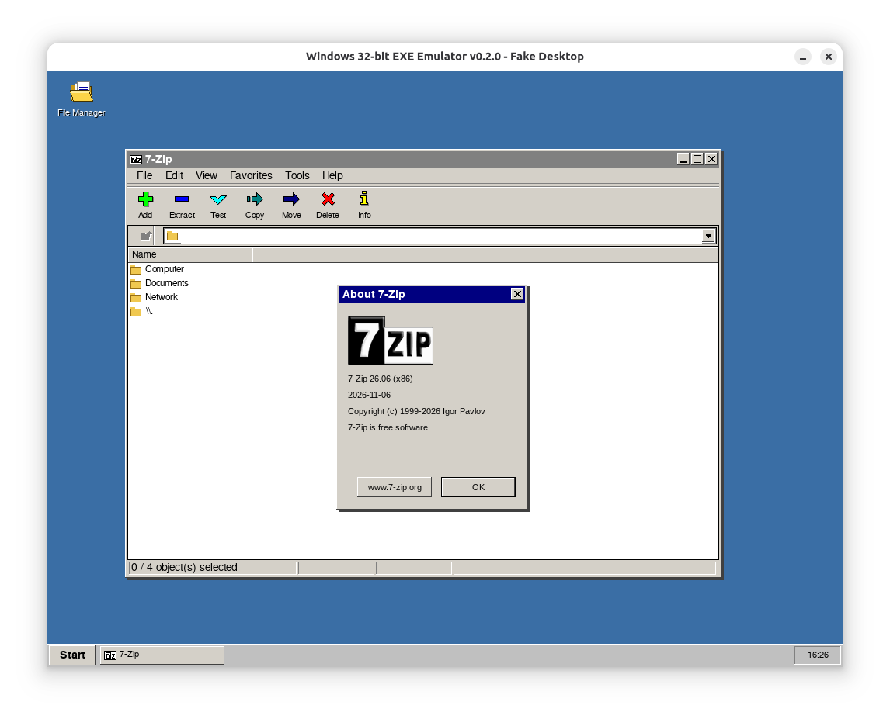

# winexe32emu

32-bit Windows EXE emulator in Python. Written with GitHub Copilot and Claude AI.



## Installation

```bash
pip install -r requirements.txt
```

Pygame (`pygame-ce`) is optional: it is only needed for the fake desktop and sound.

The apps (like the file manager) and the test programs are compiled with the 32-bit MinGW-w64 toolchain (`i686-w64-mingw32-gcc` and `i686-w64-mingw32-windres`):

| System | Command |
| --- | --- |
| Debian / Ubuntu | `sudo apt install gcc-mingw-w64-i686` |
| Fedora | `sudo dnf install mingw32-gcc` |
| Arch Linux | `sudo pacman -S mingw-w64-gcc` |
| macOS (Homebrew) | `brew install mingw-w64` |

## Usage

Put EXE files in the c_drive/ folder (the emulated `C:\`). Then run:

```bash
python3 winexe32emu.py
```

Use `-h` parameter for command-line help.

Everything after the EXE name is passed to the program as its command line, for example:

```bash
python3 winexe32emu.py --no-gui "C:\Program Files\7-Zip\7z.exe" a "C:\Windows\Temp\test.7z" "C:\Windows\Temp\file_test.tmp"
```

The emulator exits with the command-line program's exit code (1 if the emulated program crashes).

The ANSI code page (`GetACP`, the "A" APIs and narrow C runtime strings) is `cp1252` by default, like an English (United States) Windows. Use `--codepage` to change it, for example `--codepage cp1254` for a Turkish Windows or `--codepage utf-8` for programs whose narrow strings are UTF-8 (MinGW string literals are).

## Tests

```bash
python3 winexe32emu.py --tests
```

compiles the test programs in `tests/` and runs each one in the emulator without the GUI (the exit code is the number of failed tests). The unit tests of the emulator's own logic and the lint check need no toolchain:

```bash
python3 -m unittest discover -s tests/python -v
```

```bash
ruff check .
```

GitHub Actions runs all of them on every push (`.github/workflows/ci.yml`).

## Tested Programs

- 7-Zip 26.06 (x86): the command-line `7z.exe` (adding to, testing and listing archives) and the file manager `7zFM.exe` (see the screenshot above)
- The file manager in `apps/filemanager/` and the test programs in `tests/`

## Known Limitations

- Only the English (United States) locale exists, and the emulated machine has one drive (`C:`, the `c_drive/` folder).
- No DirectX (DirectDraw, Direct3D, DirectSound, DirectInput), no networking (Winsock, WinINet) and no cryptography APIs.
- Many Win32 APIs are missing or partial; an unemulated API is reported (`Unemulated API: ...`), and one whose stack arguments are unknown stops the emulation.
- Programs built with Visual C++ 2015 or later are supported by the emulated `vcruntime140`/`ucrtbase`, but they are less tested than older ones.
- Exception handlers that other compilers generate are called in the program, and one that never returns (it continues in the program) leaves the emulator's own call stack nested until the program jumps out of it.
- Memory protection (`VirtualProtect`) is not enforced: emulated memory is always readable, writable and executable.

## Folder Structure

- `apps/` - App C source codes, one folder per app (`apps/filemanager/` - File manager)
- `c_drive/` - Put your EXE files here (emulation path, `C:\`) and run them with the file manager or the command line.
- `.github/workflows/ci.yml` - GitHub Actions: lint, unit tests and the test programs
- `ruff.toml` - Lint settings
- `scripts/compile_apps.sh` - Script to compile the apps into `c_drive/Windows/` (run at every start; up-to-date apps are skipped, `--force` compiles all)
- `scripts/compile_tests.sh` - Script to compile the test programs into `c_drive/Windows/Tests/`
- `scripts/create_c_drive_environment.sh` - Script to create the `c_drive/` folders
- `scripts/remove_c_drive_environment.sh` - Script to remove the compiled apps, the compiled test programs and the empty `c_drive/` folders
- `scripts/remove_tests.sh` - Script to remove the compiled test programs
- `scripts/run_tests.sh` - Script to compile the test programs and run each one in the emulator without the GUI (exit code: number of failed tests)
- `tests/` - Test program C source codes (`NAME_dll.c` is compiled into a DLL next to `NAME.exe`)
- `tests/python/` - Unit tests of the emulator (Python `unittest`)
- `winexe32emu.py` - The main script

## Features

- PE file loading and analysis
- x86 CPU emulation (Unicorn)
- Fake Windows desktop with sound support with Pygame
- Basic Win32 API support (user32, kernel32, gdi32, advapi32, winmm, msvcrt, shell32, ole32, oleaut32, comctl32, comdlg32)
- Loading the programs' own DLLs (relocation, imports, exports, `DllMain`)
- Structured exception handling: access violations, CPU exceptions and `RaiseException` reach the program's handlers (`_except_handler3/4`, C++ `catch`, other handlers, vectored handlers, `SetUnhandledExceptionFilter`)
- A registry shared by the emulated programs and saved to `C:\Windows\System32\config\registry.json`
- Fake C drive environment support

## Versioning

- First version is 0.0.1, every major changes version is bumped to 0.0.5, 0.0.10, 0.0.15 etc, every minor changes version is bumped to 0.0.16, 0.0.17, etc. Every bigger changes version is bumped to 0.1.0, 0.2.0 etc. Every biggest changes for each stable version is bumped to 1.0.0, 2.0.0 etc.

## Disclaimer

This project is not endorsed by, affiliated with, or sponsored by Microsoft Corporation in any way. Windows, Win32, and related trademarks are the property of Microsoft Corporation. This is an independent, educational emulation project.

## Copyright and License

Copyright 2025-2026 Erdem Ersoy (eersoy93)

Licensed under the Apache License, Version 2.0 (the "License");
you may not use this file except in compliance with the License.
You may obtain a copy of the License at

    http://www.apache.org/licenses/LICENSE-2.0

Unless required by applicable law or agreed to in writing, software
distributed under the License is distributed on an "AS IS" BASIS,
WITHOUT WARRANTIES OR CONDITIONS OF ANY KIND, either express or implied.
See the License for the specific language governing permissions and
limitations under the License.
