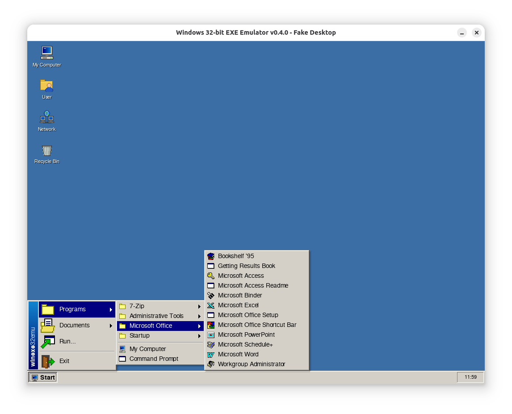

# winexe32emu

[](https://github.com/eersoy93/winexe32emu/actions/workflows/ci.yml)
[](LICENSE)


**A 32-bit Windows EXE emulator written in Python.** It loads classic Windows programs, runs their code on an emulated x86 CPU and shows their windows on its own fake Windows desktop — no Windows needed.

Written with GitHub Copilot and Claude AI.



## Contents

- [Features](#features)
- [Supported Programs](#supported-programs)
- [Getting Started](#getting-started)
- [Usage](#usage)
- [Running the Tests](#running-the-tests)
- [Not Supported (Currently)](#not-supported-currently)
- [Versioning](#versioning)
- [Contributing](#contributing)
- [Disclaimer](#disclaimer)
- [Copyright and License](#copyright-and-license)

## Features

- 🖥️ **Fake Windows desktop** with a taskbar, a Start menu (Programs, Documents, Run...), windows, dialogs and sound
- 🗑️ **Desktop folders**: the user's folder, Network and a Recycle Bin
- 📦 **Runs real programs**: setups and applications, several of them side by side
- 💾 **Virtual drives**: A: (floppy disk), C: (hard disk) and D: (CD-ROM) are plain folders in `drives/`
- 🔒 **Sandboxed**: programs can only reach the files inside their virtual drives
- 🗂️ **A shared registry** that the emulated programs keep between runs
- 🌐 **Offline by design**: programs see a PC without a network
- 🧩 **Built-in apps**: Explorer, Notepad, Command Prompt and a simple Windows Help
- 🔍 **Missing API report**: see what a program needs that is not emulated yet

## Supported Programs

These are playable, but may not be supported 100%:

| Program | What works |
| --- | --- |
| 7-Zip 4.65 (x86) | NSIS setup and programs |
| 7-Zip 9.20 (x86) | NSIS setup and programs |
| 7-Zip 26.06 (x86) | Setup and programs |
| Ants | Setup and program |
| Microsoft Office 95 Professional | Setup, Word, Excel, PowerPoint, Access, Schedule+, Binder, Office Shortcut Bar |
| Ski32 | Program |

## Getting Started

You need **Python 3.11 or newer**. winexe32emu runs from its repository folder; it is not installed as a package.

```bash
git clone https://github.com/eersoy93/winexe32emu.git
cd winexe32emu
pip install -r requirements.txt
```

The built-in apps and the test programs also need the 32-bit MinGW-w64 compiler (e.g. `sudo apt install gcc-mingw-w64-i686` on Debian / Ubuntu). [CONTRIBUTING.md](CONTRIBUTING.md#sending-changes) lists the commands for other systems.

## Usage

1. Put your EXE files in one of the virtual drives:

   | Folder | Drive |
   | --- | --- |
   | `drives/A` | A: (floppy disk) |
   | `drives/C` | C: (hard disk) |
   | `drives/D` | D: (CD-ROM, read-only for the programs) |

2. Start the fake desktop and run your programs from the Start menu:

   ```bash
   python3 winexe32emu.py
   ```

   Or run a program directly:

   ```bash
   python3 winexe32emu.py myprogram.exe
   ```

Useful options:

| Option | What it does |
| --- | --- |
| `-h` | Shows all the options |
| `--no-gui` | Runs a console program without the fake desktop |
| `--codepage cp1254` | Uses another ANSI code page (e.g. Turkish) |
| `--missing-apis` | Lists what a program needs that is not emulated yet |
| `--clean` | Deletes the virtual drives (asks first) |

## Running the Tests

```bash
python3 winexe32emu.py --tests
```

This compiles and runs the test programs. The unit tests and the linter are described in [CONTRIBUTING.md](CONTRIBUTING.md#sending-changes).

## Not Supported (Currently)

- 64-bit (x64) programs, and 16-bit DOS and Windows 3.x programs
- .NET programs
- DirectX, OpenGL and other hardware graphics
- A real network
- Programs working together while running (e.g. editing a Word document inside Binder)
- Drivers and services

## Versioning

Small releases raise the last number (0.0.16, 0.0.17…), and every fifth one is a major release (0.0.5, 0.0.10…). Big milestones raise the middle number (0.3.0, 0.4.0…), and 1.0.0 will be the first stable release. The changes of each version are in [CHANGELOG.md](CHANGELOG.md).

## Contributing

Contributions are welcome: see [CONTRIBUTING.md](CONTRIBUTING.md). Contributions must be based only on legally obtained information, never on Windows source code.

## Disclaimer

This project is not endorsed by, affiliated with, or sponsored by Microsoft Corporation in any way. Windows, Win32, and related trademarks are the property of Microsoft Corporation. This is an independent, educational emulation project.

## Copyright and License

Copyright 2025-2026 Erdem Ersoy (eersoy93)

Licensed under the [Apache License, Version 2.0](LICENSE). The software is distributed on an "AS IS" basis, without warranties or conditions of any kind.
