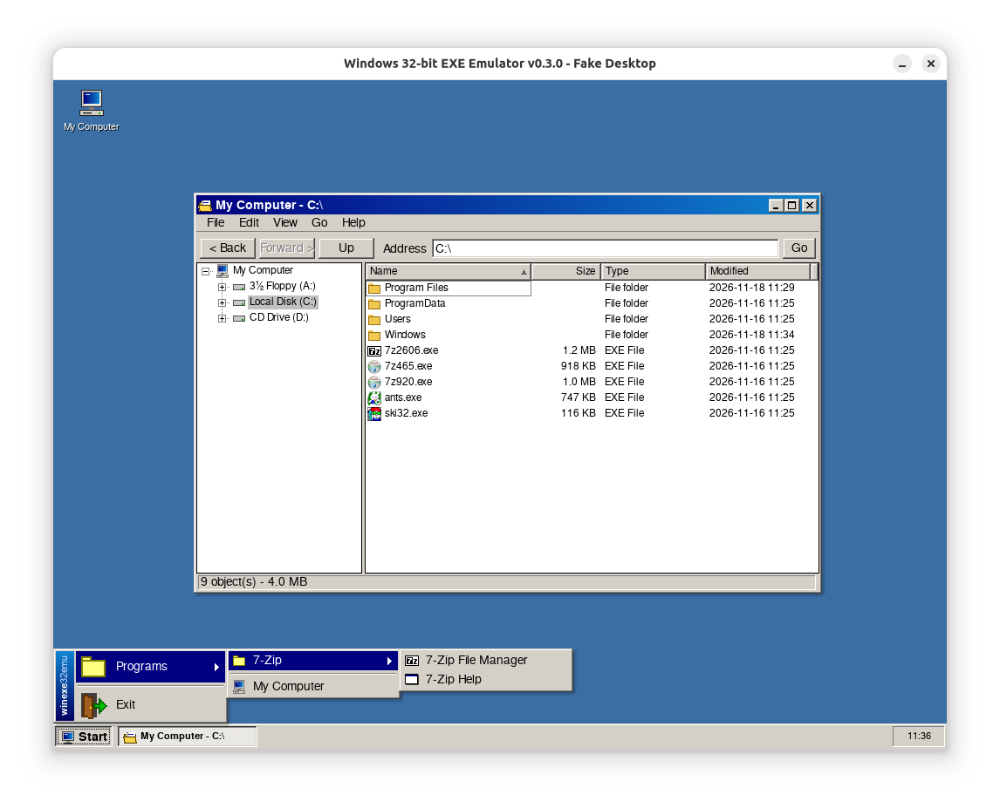

# winexe32emu

32-bit Windows EXE emulator in Python. Written with GitHub Copilot and Claude AI.



## Installation

winexe32emu needs Python 3.11 or newer. It runs from its repository folder (it is not installed as a package):

```bash
pip install -r requirements.txt
```

Pygame (`pygame-ce`) is optional: it is only needed for the fake desktop and sound.

The apps (like Explorer) and the test programs are compiled with the 32-bit MinGW-w64 toolchain (`i686-w64-mingw32-gcc` and `i686-w64-mingw32-windres`):

| System | Command |
| --- | --- |
| Debian / Ubuntu | `sudo apt install gcc-mingw-w64-i686` |
| Fedora | `sudo dnf install mingw32-gcc` |
| Arch Linux | `sudo pacman -S mingw-w64-gcc` |
| macOS (Homebrew) | `brew install mingw-w64` |

## Usage

Put your EXE files in drives/A (virtual floppy disk), or drives/C (virtual hard disk) or drives/D (virtual CD-ROM), and then:

```bash
python3 winexe32emu.py
```

Use `-h` parameter for command-line help.

To see which APIs a program needs but the emulator does not emulate yet, check the summary at the end of its run, or collect them in a file with `--missing-apis FILE`.

## Running the Tests

```bash
# Lint and unit tests (no MinGW-w64 needed; the fake desktop's test uses SDL's dummy driver)
pip install ruff
ruff check .
SDL_VIDEODRIVER=dummy python3 -m unittest discover -s tests/python -v

# Emulator tests: compiles the C programs in tests/ into C:\Windows\Tests and runs each
# one (exit code: number of failures)
python3 winexe32emu.py --tests
```

A single test program can be run on its own, e.g. `python3 winexe32emu.py --no-gui api_test.exe`. GitHub Actions runs all of these on every push.

## Not Supported (Currently)

- 64-bit (x64) programs, and 16-bit DOS and Windows 3.x programs
- .NET programs (the .NET runtime is not emulated)
- DirectX, OpenGL and other hardware graphics; the fake desktop draws with GDI only
- A real network: Windows Sockets only resolve localhost and create no sockets
- Drivers, services and other system components
- APIs the emulator lacks: a program that calls one gets 0 (see `--missing-apis`), and one with an unknown calling convention stops the program
- Execution protection (DEP) of the heap: `malloc` memory stays executable even for NX-compatible programs (`VirtualAlloc` and `VirtualProtect` memory is protected)

## Tested Programs

- 7-Zip 4.65 (x86, NSIS setup and programs)
- 7-Zip 9.20 (x86, NSIS setup and programs)
- 7-Zip 26.06 (x86, setup and programs)
- Ants (setup and program)
- Microsoft Office 95 (Professional, installer only)
- Ski32

## Features

- PE file loading and analysis
- x86 CPU emulation (Unicorn)
- Fake Windows desktop with sound support with Pygame
- Basic Win32 API support
- An offline network: sockets resolve only localhost and create no sockets (currently)
- Page protections and DEP for NX-compatible programs
- Structured Exception Handling
- A registry shared by the emulated programs
- Emulated drives: A: (floppy disk), C: and D: (CD-ROM) in drives/
- Windows file name rules on the virtual drives
- Apps: explorer.exe, winhlp32.exe (stub)

## Versioning

- First version is 0.0.1, every major changes version is bumped to 0.0.5, 0.0.10, 0.0.15 etc, every minor changes version is bumped to 0.0.16, 0.0.17, etc. Every bigger changes version is bumped to 0.1.0, 0.2.0 etc. Every biggest changes for each stable version is bumped to 1.0.0, 2.0.0 etc.

## Disclaimer

This project is not endorsed by, affiliated with, or sponsored by Microsoft Corporation in any way. Windows, Win32, and related trademarks are the property of Microsoft Corporation. This is an independent, educational emulation project.

## Copyright and License

Copyright 2025-2026 Erdem Ersoy (eersoy93)

Licensed under the Apache License, Version 2.0 (the "License");
you may not use this file except in compliance with the License.
You may obtain a copy of the License at

    http://www.apache.org/licenses/LICENSE-2.0

Unless required by applicable law or agreed to in writing, software
distributed under the License is distributed on an "AS IS" BASIS,
WITHOUT WARRANTIES OR CONDITIONS OF ANY KIND, either express or implied.
See the License for the specific language governing permissions and
limitations under the License.
