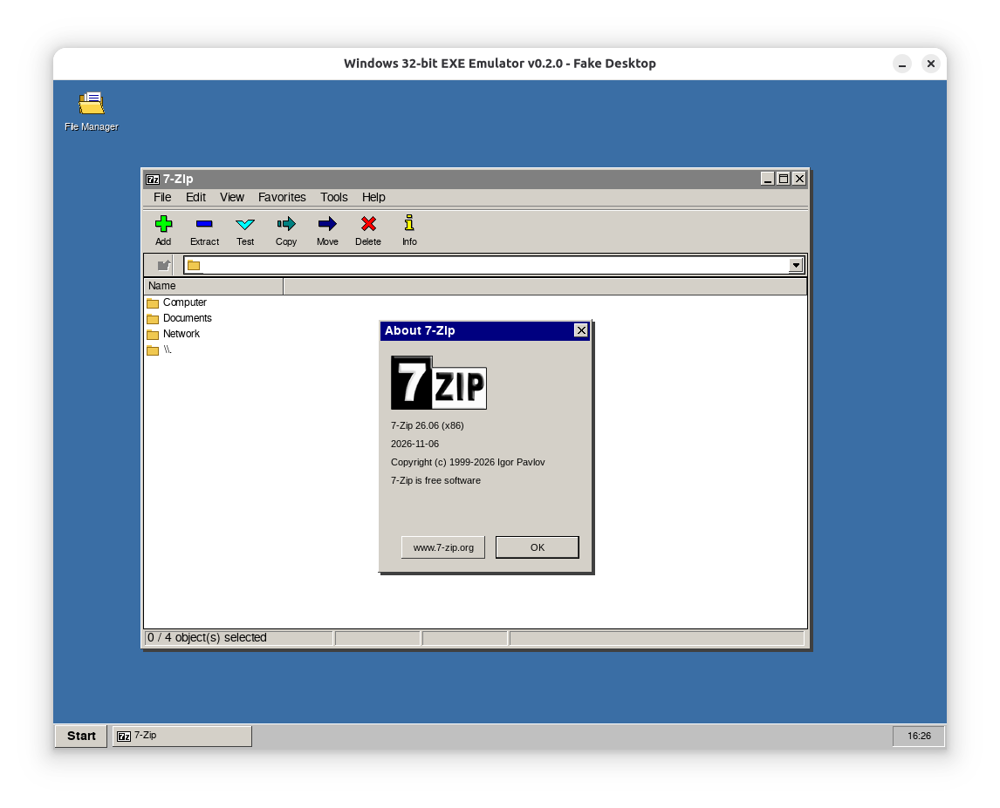

# winexe32emu

32-bit Windows EXE emulator in Python. Written with GitHub Copilot and Claude AI.



## Installation

```bash
pip install -r requirements.txt
```

Also you should install a building toolchain (MinGW-w64) for apps and tests.

## Usage

Put EXE files in the c_drive/ folder (the emulated `C:\`). Then run:

```bash
python3 winexe32emu.py
```

Use `-h` parameter for command-line help.

Everything after the EXE name is passed to the program as its command line, for example:

```bash
python3 winexe32emu.py --no-gui "C:\Program Files\7-Zip\7z.exe" a "C:\Windows\Temp\test.7z" "C:\Windows\Temp\file_test.tmp"
```

The emulator exits with the command-line program's exit code (1 if the emulated program crashes).

## Folder Structure

- `apps/` - App C source codes, one folder per app (`apps/filemanager/` - File manager)
- `c_drive/` - Put your EXE files here (emulation path, `C:\`) and run them with the file manager or the command line.
- `scripts/compile_apps.sh` - Script to compile the apps into `c_drive/Windows/` (run at every start)
- `scripts/compile_tests.sh` - Script to compile the test programs into `c_drive/Windows/Tests/`
- `scripts/create_c_drive_environment.sh` - Script to create the `c_drive/` folders
- `scripts/remove_c_drive_environment.sh` - Script to remove the compiled apps, the compiled test programs and the empty `c_drive/` folders
- `scripts/remove_tests.sh` - Script to remove the compiled test programs
- `scripts/run_tests.sh` - Script to compile the test programs and run each one in the emulator without the GUI (exit code: number of failed tests)
- `tests/` - Test program C source codes (`NAME_dll.c` is compiled into a DLL next to `NAME.exe`)
- `winexe32emu.py` - The main script

## Features

- PE file loading and analysis
- x86 CPU emulation (Unicorn)
- Fake Windows desktop with sound support with Pygame
- Basic Win32 API support (user32, kernel32, gdi32, advapi32, winmm, msvcrt, shell32, ole32, oleaut32, comctl32, comdlg32)
- Loading the programs' own DLLs (relocation, imports, exports, `DllMain`)
- Fake C drive environment support

## Versioning

- First version is 0.0.1, every major changes version is bumped to 0.0.5, 0.0.10, 0.0.15 etc, every minor changes version is bumped to 0.0.16, 0.0.17, etc. Every bigger changes version is bumped to 0.1.0, 0.2.0 etc. Every biggest changes for each stable version is bumped to 1.0.0, 2.0.0 etc.

## Disclaimer

This project is not endorsed by, affiliated with, or sponsored by Microsoft Corporation in any way. Windows, Win32, and related trademarks are the property of Microsoft Corporation. This is an independent, educational emulation project.

## Copyright and License

Copyright 2025-2026 Erdem Ersoy (eersoy93)

Licensed under the Apache License, Version 2.0 (the "License");
you may not use this file except in compliance with the License.
You may obtain a copy of the License at

    http://www.apache.org/licenses/LICENSE-2.0

Unless required by applicable law or agreed to in writing, software
distributed under the License is distributed on an "AS IS" BASIS,
WITHOUT WARRANTIES OR CONDITIONS OF ANY KIND, either express or implied.
See the License for the specific language governing permissions and
limitations under the License.
