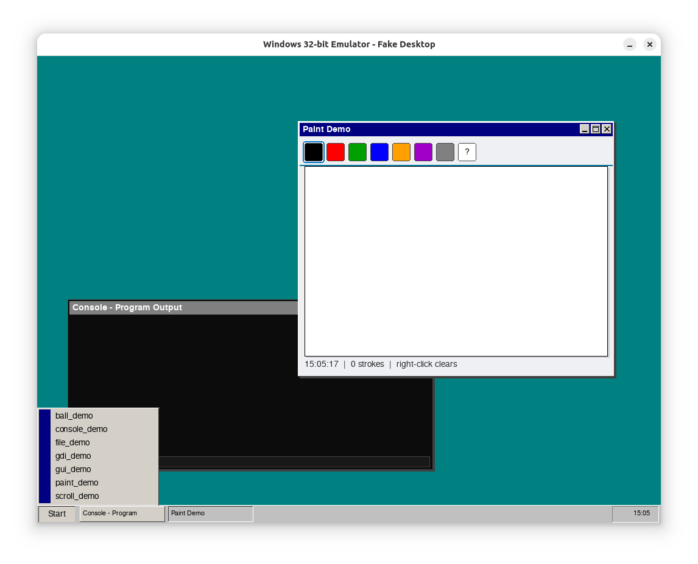

# winexe32emu

32-bit Windows EXE emulator in Python. Written with GitHub Copilot and Claude AI.



## Installation

```bash
pip install -r requirements.txt
```

## Usage

Put EXE files in the c_drive/ folder (the emulated `C:\`) or compile the examples with `./create_c_drive_environment.sh`; the demo EXEs are placed in `c_drive/Windows/Demos/`, which the program sees as `C:\Windows\Demos`. After that, run:

```bash
python3 winexe32emu.py gdi_demo.exe
```

A bare EXE name is searched in `C:\` first and then in `C:\Windows\Demos`; a Windows path inside the emulated drive (e.g. `"C:\Windows\Demos\gdi_demo.exe"`) works too.

Use `-h` parameter for command-line help. For programs using a legacy ANSI code page (e.g. Turkish text), add `--codepage cp1254` (default: `utf-8`).

Use `-v` to see every API call and other debug output, or `-q` to see only the program output, warnings and errors.

With the GUI, the EXE name is optional: the Start menu on the fake desktop lists the EXE files in `C:\`, and the demos in `C:\Windows\Demos` under its own *Demos* submenu. Each selected program starts next to the ones already running.

Like on Windows, only console (`SUBSYSTEM_CONSOLE`) programs start with a console window; GUI programs get one only if they call `AllocConsole`. Every program has its own console, which stays open after the program ends; closing it while the program runs ends the program.

The emulator exits with the command-line program's exit code (1 if the emulated program crashes).

## Folder Structure

- `c_drive/` - Put your EXE files here (emulation path, `C:\`)
- `c_drive/Windows/Demos/` - Compiled example EXEs (`C:\Windows\Demos`)
- `examples/` - Example C source codes
- `create_cdrive_environment.sh` - Script to compile examples into `c_drive/Windows/Demos/`
- `winexe32emu.py` - The main script

## Features

- PE file loading and analysis
- x86 CPU emulation (Unicorn)
- Fake Windows desktop with sound support with Pygame
- Basic Win32 API support (user32, kernel32, gdi32, advapi32, winmm, msvcrt)
- Fake C drive support

## Versioning

- First version is 0.0.1, every major changes version is bumped to 0.0.5, 0.0.10, 0.0.15 etc, every minor changes version is bumped to 0.0.16, 0.0.17, etc.

## Disclaimer

This project is not endorsed by, affiliated with, or sponsored by Microsoft Corporation in any way. Windows, Win32, and related trademarks are the property of Microsoft Corporation. This is an independent, educational emulation project.

## Copyright and License

Copyright 2025-2026 Erdem Ersoy (eersoy93)

Licensed under the Apache License, Version 2.0 (the "License");
you may not use this file except in compliance with the License.
You may obtain a copy of the License at

    http://www.apache.org/licenses/LICENSE-2.0

Unless required by applicable law or agreed to in writing, software
distributed under the License is distributed on an "AS IS" BASIS,
WITHOUT WARRANTIES OR CONDITIONS OF ANY KIND, either express or implied.
See the License for the specific language governing permissions and
limitations under the License.
